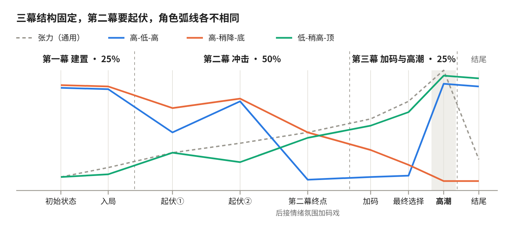

# idea-to-outline · 小说创作辅助工作流（灵感→分场细纲）

从一个简单灵感出发，经过 **灵感 → 内核 → 情节骨架 → 分场** 四步，得到整部小说的**分场细纲**：每一场挂在哪个故事节点、写多少字、发生了什么（场景内容写全）。AI 出候选，用户逐项拍板。

细纲做完后，用姊妹 skill [outline-to-prose](https://github.com/1d-a/outline-to-prose) 一场一场写成正文。

仓库里带齐了 skill 用到的全部资源：通用故事框架、知识点原文、框架总览图、编剧档案模板，以及《小老虎》的示例。换任何 agent 都能直接用。



## 目录

```
idea-to-outline/
├── SKILL.md                              # skill 本体：范围、全程规则、工具适配、第0–3步流程、交付物
├── AGENTS.md                             # 给打开本仓库的 agent 的入口提示
├── references/
│   ├── story-framework.md                # 通用故事框架（三幕结构）原文，进入第2步前读
│   └── knowledge.md                      # 知识二原文（给用户时一字不改）
├── assets/
│   ├── story-framework-overview.svg      # 框架总览图（矢量）
│   ├── story-framework-overview.png      # 框架总览图（位图）
│   ├── make_overview_svg.py              # 重新生成总览图的脚本
│   └── templates/
│       └── work-file-template.md         # 编剧档案模板
└── examples/
    └── xiao-laohu/
        └── work-file.md                  # 示例：《小老虎》第0–3步的编剧档案
```

## 安装

skill 就是这个目录本身（根目录有 `SKILL.md`，YAML frontmatter 里是 `name` 和 `description`）。放到各 agent 读取 skill 的位置即可，**文件夹名保持 `idea-to-outline`，`references/`、`assets/`、`examples/` 都要一起带上**（SKILL.md 用相对路径引用它们）。

| Agent | 做法 |
| --- | --- |
| Claude Code | `git clone https://github.com/1d-a/idea-to-outline ~/.claude/skills/idea-to-outline`（个人级）；或克隆到项目的 `.claude/skills/idea-to-outline`（项目级） |
| Claude 应用（网页 / 桌面） | 在本页点 Code → Download ZIP，在 Claude 的技能设置里上传这个 zip。只上传 SKILL.md 会缺参考原文和模板 |
| Codex 及其他支持 `SKILL.md` 的 agent | 克隆到该 agent 的 skills 目录，例如 `~/.codex/skills/idea-to-outline` |
| 不支持 skill 的 agent | 克隆到任意位置，在系统提示词或 `AGENTS.md` 里写：“用户想把灵感发展成小说故事、写细纲或分场时，先读 `<路径>/SKILL.md` 并严格按它执行” |

不需要装任何依赖。只有重画总览图时才用到 Python 3（见下面“重画总览图”）。

想把整条流程一起装上，就把 [outline-to-prose](https://github.com/1d-a/outline-to-prose) 也按同样方式装好。

## 使用

直接对 agent 说出你的灵感，例如：

> 我有个灵感：一个幻想自己是骑士的人，在危难之际挺身而出，成为了真正的骑士。帮我发展成小说。

agent 会先讲第0步的做法，再一步步带你确认。第3步做完，它会提醒你换用 outline-to-prose 写正文。

## 在不同 agent 里的差异

流程和规则不变，变的只是工具（详见 SKILL.md“工具适配”）：

- 没有弹窗提问工具：在聊天里用 A/B/C/D 列 4 个候选，等你回答。
- 没有可评论的文档工具：编剧档案用 `<作品名>-编剧档案.md`，你直接改文件。
- 没有评论功能：在聊天里说要改哪里，或直接写进文件。

## 重画总览图

```bash
python3 assets/make_overview_svg.py assets/story-framework-overview.svg
```

PNG 用任意工具从 SVG 转出即可（浏览器截图、`rsvg-convert`、Playwright 等）。改了框架的结构，记得同时改 `references/story-framework.md`。

## 范围

覆盖到分场细纲为止。每场的刺激点和正文交给 outline-to-prose。结尾战神的具体设计、伏笔与回收、开头暂时都不做。
