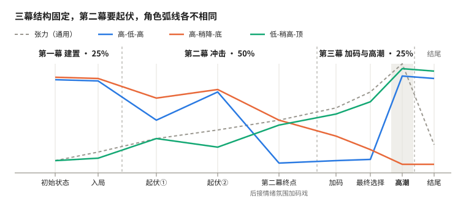

# 通用故事框架（三幕结构）

## 核心：一切围绕高潮

高潮 ＝ 角色的最终选择 ＋ 兑现火花。框架分两层：**三幕结构固定**，只规定每一幕的功能；**角色弧线可变**，每个故事选一种，决定信念往哪个方向走。

- **终点离起点越远，弧线越有力**：第一幕把起点立清楚，高潮时的变化才看得见。
- **从高潮倒推**：先定高潮，再问它需要观众心里已经装着什么，由此设计前面每一段。
- **结尾必须是结尾战神**：高潮之后，再把观众的情绪极其强烈地调动一次，见“结尾”一节。

## 总览

（同图 PNG 版：`assets/story-framework-overview.png`）

三幕和张力的走向对所有故事通用：张力从引发事件起一路攀升到第三幕结尾的高潮，结尾回落。角色的信念则按各自的弧线走。图中的三种只是例子，弧线远不止这三种。

**高潮相关价值**：图中角色弧线画的那条线，就是高潮相关价值的走向。每个故事要定下自己的高潮相关价值，比如在「堂吉柯德--猫猫 老虎」故事中，高潮相关价值定为主角的信念。

**三幕比例**：「初始状态+入局」：「高潮相关价值」：「最终战斗」=25%：50%：25%。初始状态+入局大体对应第一幕，高潮相关价值对应第二幕，最终战斗对应第三幕。

## 第一幕 建置：立起角色的起点

第一幕只立起角色的起点：他信什么、想要什么。起点可高可低，由弧线决定。具体怎么开场、埋什么伏笔，都留到后面的情节设计。示例列只作示意。

第一幕包括「初始状态」和「入局」两部分，对应三幕比例里的「初始状态+入局」，分场时各一场。小老虎：初始状态是它坚信自己是老虎，入局是它被推举为林子的守护者。

| 任务 | 要做到什么 | 设计时问自己 | 示例：小老虎 |
| --- | --- | --- | --- |
| 立起点 | 让观众看清角色起点的信念和渴望；终点离它越远，弧线越有力 | 他信什么、想要什么？起点在弧线的哪一端？ | 小猫坚信自己是老虎 |

## 第二幕 冲击：高潮相关价值的起伏

第二幕由外部的引发事件开启，之后高潮相关价值一次次起伏。设计时不单独设计引发事件，直接设计高潮相关价值的每一次起伏，引发事件是起伏的一部分。起伏的方向和终点，由弧线和内核决定。示例列只作示意。

**第二幕必须有起伏**：高潮相关价值在第二幕，正常来讲必须有起伏，即波动升降。篇幅太短的，可以不波动，从上到下或从下到上即可。

第二幕的终点由内核决定：如堂吉柯德式的故事，第二幕的终点是信念↓到极致，第三幕才能在悲怆中彻底燃起。

设计时倒着来：先定第二幕的终点，再一次一次往前定。

**第二幕结束后的情绪加码**：第二幕最后情节之后，要有情绪氛围的加码戏，来展现高潮价值至此的转换。也因此，第二幕最后一场要加长。

| 节点 | 承担的任务 | 设计时问自己 | 示例：小老虎 |
| --- | --- | --- | --- |
| 起伏（次数按体量定） | 高潮相关价值波动升降；引发事件是起伏的一部分 | 放几次？每次往哪个方向走、因为什么事？ | ① ↓ 林子里来了一只流浪猫，大家都说它俩长得一模一样；② ↑ 偶遇大狗熊，它出手，熊碰巧走了，大家夸它 |
| 第二幕终点 | 由内核决定，走到这一幕的极致；最后情节之后，接情绪氛围的加码戏 | 终点要走到什么程度？加码戏怎样展现高潮价值至此的转换？ | ③ ↓ 它去对付狼，被轻易击败；救回来后把自己关进屋里，信念破碎 |

## 第三幕 情况加码与高潮：逐步逼近最终选择

第三幕里，角色一步步被推到最终选择面前，并以高潮收尾。最终选择是一个两难取舍，可以关乎生死，也可以关乎爱情、理想或做人。示例列只作示意。

| 节点 | 承担的任务 | 设计时问自己 | 示例：小老虎 |
| --- | --- | --- | --- |
| 加码 | 角色面临的境况逐渐加码 | 是否加码了 | 狼群到了，大家要撤，它跟在大家之中 → 撤离的路被挡住了，只能换路 |
| 最终选择 | 走到这里，观众已想象不出别的行动；角色面临两难：两样都想要只能选一样，或两样都不想要只能取其轻 | 他必须在什么和什么之间选？各自要付出什么？ | 逃走保住自己，还是留下让大家撤 |
| 高潮（第三幕结尾） | 角色做出最终选择，走到弧线的终点；兑现火花 | 这个选择怎样把他带到弧线的终点？ | 它转身站出来，让小动物们撤——影子化作老虎 |

## 结尾：结尾战神

结尾必须做成**结尾战神**：在结尾处，把观众的情绪极其强烈地调动起来。很多作品本身评价一般，就因为结尾这一段溢出，直接成了超级爆款。

结尾战神本身就是一段尾声，补充高潮之后发生的事，只是在其中掺入了回响这类手法来煽情。设计时直接给出整段结尾怎么做，不把尾声和回响拆开。

### 个人认为非常强的手法：回响

在结尾放回响，让人余味无穷。

回响往往不单独出现，而是跟尾声情节一起出现：《电锯人 蕾塞篇》的回响，带在蕾塞决定跟电次私奔的情节里；《龙族三》的花票回响，带在路明非在牛郎店决定去留的情节里，话语和日记的回响，带在他们坐直升机回去的情节里。

| 回响类型 | 做什么 | 例 |
| --- | --- | --- |
| 回响演过的 | 观众看过的画面、动作、台词再出现一次，此刻的意义已完全不同 | 电影《电锯人 蕾塞篇》：蕾塞用与初见时相同的分镜和动作，走向电次所在的店 |
| 回响没演过的 | 补上一段与故事相关、但没演过的过往，让已发生的一切被重新理解 | 电影《超时空辉夜姬》：辉夜八千年过往的闪回，然后给出好结局 |
| 多重回响 | 几段回响叠在一起，演过的和没演过的交替，层层推高 | 小说《龙族三》：①路明非收到绘梨衣的花票（没演过）；②路明非想起绘梨衣说过的“小怪兽与奥特曼”那句话（演过）；③绘梨衣的三行日记（没演过） |

- 演过的回响，前面得先演一次：定下结尾战神后，伏笔阶段要把它安排进前面的场次。
- 没演过的回响，必须和故事相关，不能和已经演过的内容冲突。

### 其他手法

待补充。回响只是结尾战神的手法之一，不限于此。

## 角色弧线

每个故事选一种弧线。它决定第一幕的起点、第二幕信念怎么起伏、第三幕的最终选择落在哪。表里的三种只是例子，弧线远不止这三种，灵活处理。

| 弧线 | 第一幕起点 | 第二幕的起伏 | 第三幕的最终选择 | 例 |
| --- | --- | --- | --- | --- |
| 高-低-高 | 坚信自己是老虎 | ↓ ↑ ↓，终点信念彻底破碎 | 明知不是，仍挺身而出 | 小猫老虎 |
| 高-稍降-底 | 坚守信念 | 稍稍动摇，做出一点让步 | 彻底堕落 | 堕落故事 |
| 低-稍高-顶 | 只想过好日子 | 思想有了改变 | 牺牲自己拯救世界 | 小人物拯救世界 |

## 说明

三幕篇幅按 25%：50%：25% 分配，见“总览”。开场画面、钩子这类具体呈现，不在框架里定，留到后面的步骤。
